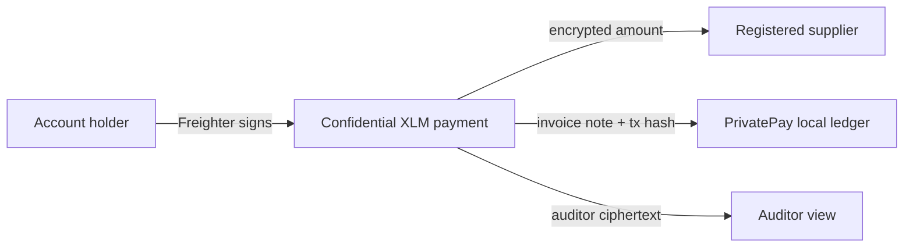

| POST | `/api/setup` | Validate that a supplier address is configured; optional server-side registration is available when `SUPPLIER_SECRET` is set. |
<div align="center">

# 🔐 PrivatePay

### Private supplier payroll on Stellar

**Pay suppliers with confidential transfer amounts, keep invoice context in your own records, and give an accountant an auditable view.**

[](https://stellar.org/)
[](https://www.freighter.app/)
[](#-important-limits)

[Problem & Solution](#-problem) · [Quick Start](#-quick-start) · [Role Walkthroughs](#-role-walkthroughs) · [How Privacy Works](#-how-privacy-works)

</div>

> [!WARNING]
> **Testnet prototype. Contracts are an unaudited developer preview. Use test assets only.** This project currently supports **XLM only**; USDC is not wired into the PrivatePay interface.

---

## The idea

### The problem

Supplier payments need to be verifiable, but publishing every payment amount can expose a small business's operating costs, supplier pricing, and payroll patterns. At the same time, an accountant still needs enough information to reconcile invoices and review the books.

### The solution

PrivatePay is a small-business payroll workspace for confidential supplier payments on Stellar. A business holder connects Freighter, deposits XLM into the confidential token, and sends a proof-backed payment. The transfer amount is hidden from ordinary public inspection while a designated auditor can decrypt it for review. PrivatePay stores the invoice note and transaction reference off-chain so the payment can still be reconciled.



## What the prototype does

- Connects an account holder's Freighter wallet and derives token-bound confidential keys from verified wallet signatures.
- Registers the holder, deposits XLM, merges receiving funds into spendable funds, and submits confidential transfers.
- Stores invoice notes, supplier address, transaction hash, and timestamp locally. **Payment amounts are not written to the app's JSON ledger.**
- Lets a supplier connect their own Freighter wallet to decrypt their incoming payments in the browser. The supplier secret is not required for viewing.
- Lets the auditor view decrypt the amounts in this workspace's recorded transfer history and export a CSV.

## Quick Start

### Requirements

- Node.js 20 or newer
- npm
- Freighter browser extension, configured for Stellar Testnet
- Testnet XLM in the account that will pay

### 1. Clone the repository

```bash
git clone https://github.com/AHKAYY007/privacy-payroll-on-stellar.git
cd privacy-payroll-on-stellar
```

### 2. Install dependencies

From the repository root:

```bash
npm run install:all
```

This installs the root process runner, backend dependencies, and frontend dependencies. The Confidential Token SDK is pinned to the fork's tested commit in both application packages.

### 3. Configure the backend

```bash
cp .env.example backend/.env
```

Open `backend/.env` and set `SUPPLIER_ADDRESS` to the supplier's **public Stellar G-address**. The supplier must already be registered on the configured confidential token, either through Freighter or with the optional backend setup key.

The checked-in defaults target the fork's public XLM-backed testnet demo deployment. If you use that deployment, use these contract IDs rather than the `C...` placeholders:

| Setting | Default demo value |
|---|---|
| `CONFIDENTIAL_CONTRACT_ID` | `CA642WUED6PACAQGVKSXND3DRSXGR7DP2L7TRHZORPWEPNRVGGN4L4ED` |
| `VERIFIER_CONTRACT_ID` | `CAN45PFA5CVUCU3JB77IE2JNWNTRCDWMRNG55U452L3N2IOCAGOLTUVQ` |
| `AUDITOR_CONTRACT_ID` | `CBQZRK72Y6KJ5DR4CUHKLHMHIKBMOZNSYTWHRUQPEXA35PRCBMSPBZTW` |
| `TOKEN_CONTRACT_ID` (underlying XLM SAC) | `CDLZFC3SYJYDZT7K67VZ75HPJVIEUVNIXF47ZG2FB2RMQQVU2HHGCYSC` |
| `TOKEN_DEPLOYED_AT_LEDGER` | `5371973` |

If you deploy different contracts, replace these values with the addresses and deployment ledger from your deployment output. `TOKEN_CONTRACT_ID` is retained as the underlying asset setting; confidential operations use `CONFIDENTIAL_CONTRACT_ID`.

#### Environment settings

| Variable | Required | Purpose |
|---|:---:|---|
| `STELLAR_RPC_URL` | Yes | Soroban RPC endpoint. The template uses Stellar Testnet. |
| `STELLAR_NETWORK_PASSPHRASE` | Yes | Network identity; keep the Testnet passphrase for the demo. |
| `CONFIDENTIAL_CONTRACT_ID` | Yes | Confidential token contract used for registration, balances, and transfers. |
| `VERIFIER_CONTRACT_ID` | Yes | Contract that verifies confidential-token proofs. |
| `AUDITOR_CONTRACT_ID` | Yes | Registry containing auditor public keys. |
| `TOKEN_CONTRACT_ID` | For reference | Underlying XLM Stellar Asset Contract for the default deployment. |
| `SUPPLIER_NAME` | Yes | Display name shown in the payroll workspace. |
| `SUPPLIER_ADDRESS` | Yes | Supplier's public `G...` account address. Never a secret. |
| `SUPPLIER_SECRET` | No | Optional supplier Stellar `S...` secret. Only use if the backend should register that supplier. Supplier-mode decryption happens in Freighter. |
| `AUDITOR_GRUMPKIN_SECRET_HEX` | For Auditor mode | Grumpkin scalar matching the public key registered for the auditor ID. This is not a Stellar `S...` key. |
| `AUDITOR_ID` | Yes | Auditor registry ID. The default demo deployment uses `0`. |
| `TOKEN_DEPLOYED_AT_LEDGER` | Yes | Token deployment ledger used as the lower bound for event sync. |
| `PORT` | No | Backend port; defaults to `3001`. |

**Never add `.env` to Git or paste a secret into chat.** The default demo auditor scalar is public demo material and is suitable only for this shared testnet prototype, never for real value.

### 4. Fund and register the accounts

1. In Freighter, switch to **Stellar Testnet** and select the account that will pay.
2. Fund it with test XLM using Freighter's testnet funding option or Stellar Friendbot.
3. Set the supplier's public address in `SUPPLIER_ADDRESS`. In Supplier mode, connect that Freighter account and approve registration if prompted; it must use the same confidential token as the payer.
4. Keep `SUPPLIER_SECRET` blank unless you explicitly want the backend to perform supplier registration. It is not needed to decrypt supplier payments in the current app.

### 5. Start the app

From the repository root, start both servers with one command:

```bash
npm run dev
```

Open the frontend URL printed by Vite, normally <http://localhost:5173>. The API runs at <http://localhost:3001>. If Vite reports that the port is occupied, use the alternate local URL it prints.

### Run the servers separately

Use two terminals, both from the repository root:

```bash
npm run dev:backend
```

```bash
npm run dev:frontend
```

The frontend proxies `/api` requests to the backend. Start the backend before using wallet, history, supplier, or auditor features.

## Role Walkthroughs

### Account holder

1. Choose **Open payroll workspace**, then stay in **Account holder** mode.
2. Click **Connect & Set Up**. Select the intended payer account in Freighter, confirm Testnet, and approve the key-derivation and registration prompts.
3. Deposit a small test amount. Deposits first land in **Receiving**; press **Merge receiving** to move funds into **Spendable**.
4. Choose the configured supplier, enter an XLM amount and invoice note, and press **Send privately**.
5. Approve the transaction in Freighter. On success, use the Stellar Expert link or the transaction history below the form.

The transaction history contains the invoice note, supplier, time, and transaction reference. It deliberately omits the amount.

### Supplier

1. Open **Supplier view**.
2. Connect Freighter using the supplier account whose public address matches `SUPPLIER_ADDRESS`.
3. Approve the two SEP-53 key-derivation signatures. If the account is not registered on this token yet, approve the registration transaction too.
4. The browser verifies signatures, derives the viewing key locally, and decrypts only incoming payments whose transaction hashes are recorded by PrivatePay.

The supplier's Stellar secret never needs to be copied into `backend/.env` for this view.

### Auditor

1. Open **Auditor view**.
2. Ensure `AUDITOR_GRUMPKIN_SECRET_HEX` and `AUDITOR_ID` in `backend/.env` match the auditor key registered on the selected deployment.
3. Refresh the payroll ledger or download its CSV.

The auditor sees amounts because auditor decryption is the intended accountability feature. This view is restricted to transaction hashes recorded by this PrivatePay workspace; it does not list every transfer on the shared demo deployment.

## How privacy works

- **Confidential transfers:** sender and recipient addresses remain visible on-chain; transfer amounts are encrypted in the confidential-token event.
- **Auditing:** the registered auditor can decrypt the audit ciphertext for recorded transfers.
- **Invoice context:** invoice notes are stored off-chain with the transaction hash, never in the confidential transfer payload.
- **Deposits and fees:** deposits and network fees are public Stellar operations. This is not a way to hide every financial relationship or all account activity.

## Architecture

| Part | Responsibility |
|---|---|
| `frontend/` | Vite + React payroll UI, Freighter access, key derivation, browser proof generation, and supplier-side decryption. |
| `backend/` | Express API, public chain configuration, supplier registration verification, invoice metadata JSON store, auditor decryption, and CSV export. |
| SDK dependency | Pinned `stellar-confidential-token-sdk` package from GitHub, used for proofs, chain operations, and confidential state. The separate Next.js demo is not the PrivatePay frontend. |

The frontend vendors the SDK-pinned bb.js browser files before `dev` and `build`, and sends the COOP/COEP headers required by browser proof generation.

## API

| Method | Path | Purpose |
|---|---|---|
| `GET` | `/api/config` | Public RPC, contract, auditor ID, and supplier settings. |
| `POST` | `/api/setup` | Verify or register the configured supplier account. |
| `GET` | `/api/payments` | Return recent invoice metadata and hashes; contains no payment amounts. |
| `POST` | `/api/payments` | Save invoice metadata after the wallet submits a transfer. |
| `GET` | `/api/auditor/ledger` | Return the audited ledger for app-recorded hashes. |
| `GET` | `/api/auditor/export.csv` | Download the app-scoped audited ledger. |

## Important limits

- **Testnet only.** The contracts and proving stack are an unaudited developer preview.
- **XLM only in this PrivatePay UI.** The token fork has an advanced underlying-asset deployment flow, but this app is not yet multi-asset and does not currently send USDC.
- **Recent event history.** Soroban RPC retains a limited event window (about a week). Without an indexer, old transfers may no longer be available for decryption.
- **Browser state is sensitive.** Reconstructed confidential openings are stored in the browser's local storage. Use a dedicated test profile and test accounts.
- **Shared demo auditor key.** The demo auditor secret is publicly embedded in the reference fork. It is not private and must not be used for real funds or production deployments.

## Development checks

```bash
cd backend && npx tsc --noEmit -p tsconfig.json
cd ../frontend && npm run build
```

Automated tests are intentionally not included in this hackathon project.
